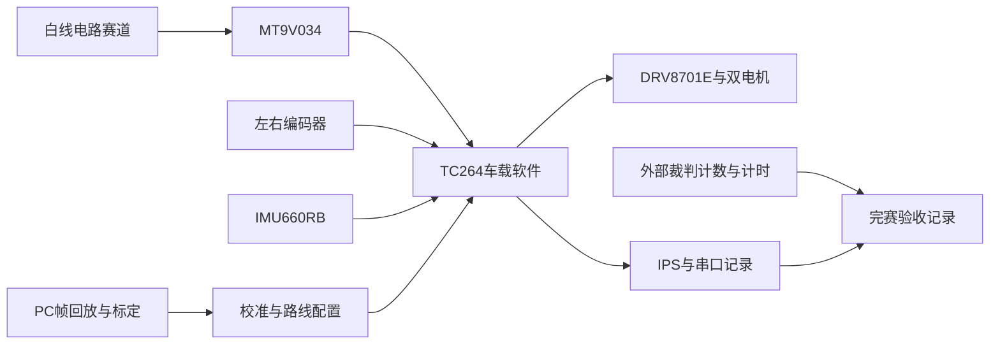
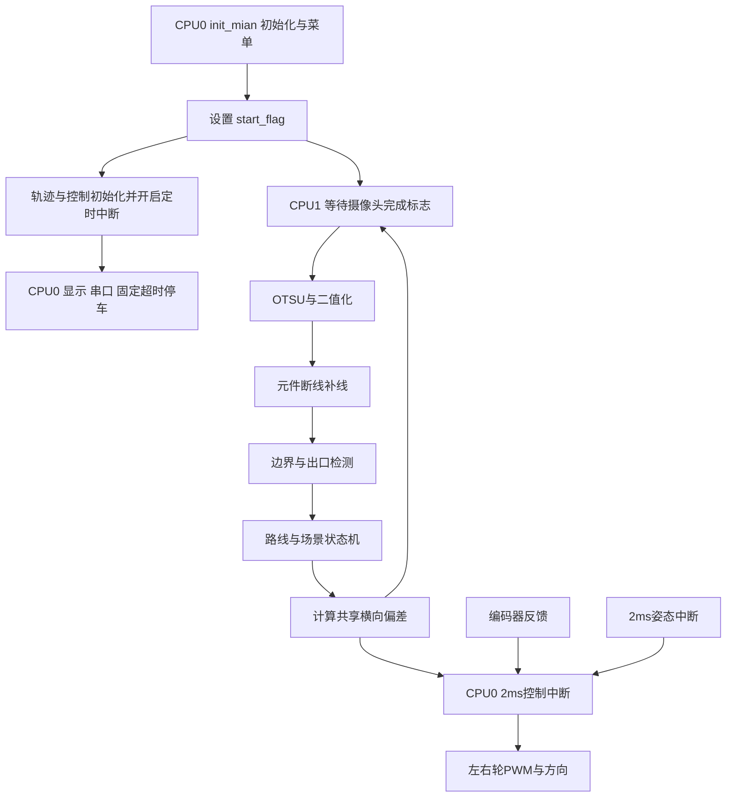
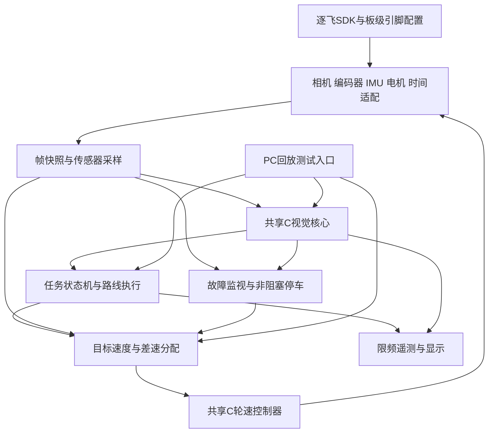

# 疯狂电路视觉智能车：软件架构

日期：2026-11-14。适用硬件：v0.3，TC264_BTB、MT9V034/120°、130双电机差速、DRV8701E、双编码器、IMU660RB、IPS114。SRAM总规格固定为240KB，本文KB均为1024B。

规则补充：用户随后明确技术细节参照第21届全国赛疯狂电路组，已核对[全国赛规则基线](../research/2026-11-14-national21-rule-baseline.md)。文杰杯三科赛制、全国赛后期单科安排、国赛75%覆盖门槛分别记录；本文“两元件闭合路线”为初期里程碑和校赛PPT最低口径，不能代替国赛覆盖要求。

本文把**当前源码实际架构**和**本车待实现架构**分开。当前只有锁定的Soberup参考源码、资料和下载校验工具；未见本车集成固件、ADS构建产物、链接映射或实车验收记录。源码存在不代表本车已经实现。[完赛评估](../assessment/2026-11-14-finish-readiness.md)列出具体缺口。

## 1. 任务与系统边界

比赛依据为本地2026年5月24日宣讲PPT第11—14页；用户于2026-11-14确认规则无调整。视觉组为疯狂电路组：串联、并联、复杂串并联三个科目。每科从发车区出发并返回，裁判有效经过元件数N≥2；漏件允许但加罚。单科成绩为T=T1+T2+30×(M−N)，三科成绩求和，未完成或放弃某科记278秒。278秒是计分值，不能直接设成运行超时。

软件职责是沿白线行驶、跨越元件图案造成的引导线干扰、识别分支、执行满足该比赛阶段覆盖门槛的闭合路线并返回；车载视觉的元件事件不等于裁判红外装置记录的N。不要求先实现神经网络或在线全局最优规划，但采用国赛75%口径时必须有对应覆盖路线。全国规则已明确AURIX、指定ST IMU和重量换算，问答允许逐飞IMU成品板并确认赛道提前公布；本车RB芯片型号方向匹配。校赛具体起点触发、公布地图和现场任务仍须对应场地落实。全国自制PCB要求也应独立检查，不能由本车套件配置推定合规。

## 2. 当前仓库与版本边界

| 路径 | 当前职责 | 修改边界 |
| --- | --- | --- |
| `docs/` | 硬件、规则提取、调研、计划、架构和评估 | 本项目持续维护 |
| `soberup/README.md`、`baseline-selection.json` | 选用模块、38个C/H文件的分组和移植入口 | 记录选择，不代表独立可构建包 |
| `soberup/upstream/` | 原始完整main快照，707文件 | 保持原样；不在这里移植本车 |
| `soberup/upstream-manifest.json` | 文件SHA256、Git对象和树校验清单 | 固定来源证据 |
| `tools/vendor_soberup.py` | 下载与无ZIP离线完整性校验 | 数据来源工具，不是车载程序 |

参考版本固定为Soberup提交`7abfdac0d0156576ba5186716a7c1e42992359ca`，Git根树`0a17400d274d55768758f326566368ad1c4b23c6`。随附逐飞SDK为V3.4.1。此前核验的逐飞官方TC264库为V3.4.6、提交`9adccd9caa536ce6bfb5deea4107e186c65c77b9`；作为后续建本车工程的候选基础，不与原快照混写，也不声称已集成。官方版本证据见[硬件核验](../hardware-profile.md)。

上游目录职责：

| 上游目录/文件 | 作用 | 阅读重点 |
| --- | --- | --- |
| `user/` | 双核入口和中断入口 | 谁调用视觉、谁控制电机、启动先后关系 |
| `code/` | 图像、边界、场景、路线、控制、姿态、轨迹等业务 | 硬件依赖、共享变量、原赛道参数 |
| `code/menu/` | 菜单、参数编辑和显示交互 | 参数加载时机；不可成为控制阻塞路径 |
| `libraries/zf_device/` | 摄像头、IMU、屏幕等设备驱动 | 型号、采集缓存、数据单位 |
| `libraries/zf_driver/` | 定时器、GPIO、SPI、编码器等外设封装 | 通道、引脚、中断资源冲突 |
| `libraries/infineon_libraries/` | 芯片底层与iLLD | 依赖保留，初期不改底层 |
| `.project`、`.cproject`、`.settings/` | ADS工程与编译环境配置 | 工具链、包含路径、源文件编码 |
| `Lcf_Tasking_Tricore_Tc.lsl` | 内存段、栈、CSA和链接布局 | 逐区检查.map，不能只求总和 |

更细的逐文件说明见[源码阅读指南](../soberup-project-walkthrough.md)。

## 3. 当前实际执行架构

实际入口与边界如下；以下描述是静态源码结果，不是实测时序。

| 模块 | 输入→输出 | 主要源码 | 本车复用判断 |
| --- | --- | --- | --- |
| 启动 | 外设、Flash参数、菜单→启动标志及控制中断 | `user/cpu0_main.c`、`code/initialize.c` | 重写启动组织，删除本车无关负压动作 |
| 视觉预处理 | 灰度帧→阈值、8位二值图 | `code/image.c` | 可提取，曝光和局部阈值需本车数据验证 |
| 断线修复 | 二值图、线宽/距离标定→补线结果 | `code/dashedline_makeup.c` | 可参考；固定16cm等标定不能沿用 |
| 边界与出口 | 二值图→左右边界、有效出口 | `code/maze.c`、`element_line.c` | 优先提取；应返回有效性与置信度 |
| 路口行为 | 出口、路口序号、路线表、姿态→入弯/出弯状态 | `state_control.c`、`route_config.c`、`route_progress.c` | 原路线属于原比赛；需要本赛题任务层 |
| 方向偏差 | 边界和状态→共享`error` | `code/line.c` | 数学思路可复用，替换共享数据发布方式 |
| 差速与轮速闭环 | 基础速度、偏差、编码器→左右PWM | `code/motor.c`、`encoder.c` | 需确定量纲、方向、采样周期并重新调参 |
| 姿态 | IMU660RC数据→姿态角 | `code/MahonyAHRS.c` | 本车RB设备适配、零偏及轴向重做 |
| 轨迹/里程 | 轮计数、航向→记录与重定位辅助 | `inertial_navigation.c`、`map_event.c` | 首版默认不搬3072点轨迹记录 |
| 停车 | 超时、路线结束、丢线/姿态/堵转→禁用电机 | `motor.c`及调用方 | 有保护基础，但需要统一非阻塞故障通路 |

注意两类“元素”不同：`element_line`主要描述赛道几何和出口，不等于已实现裁判元件唯一ID、有效经过统计或比赛成绩计算。

当前时序：`CCU60_CH0`为2ms，即500Hz轮速闭环；方向控制在`combined_control()`内每两次更新一次，名义250Hz。IMU另一个2ms中断。视觉随摄像头完成事件运行，没有提供持续帧率和最坏耗时记录。CPU0诊断显示按20ms检查，即最高约50Hz；这些都不是本车已批准的最终调度参数。

当前关键耦合：大量文件通过`zf_common_headfile.h`隐式引入业务全局变量；CPU1写偏差、CPU0中断读取；摄像头以完成标志交接，下一VSYNC可重新写同一帧；菜单初始化后，启动标志发布与CPU0再次重置INS之间可能并行处理；停车函数含500ms阻塞。详见[软件专项检查](../assessment/2026-11-14-software-compliance-audit.md)。

## 4. 本车目标架构：共享C核心和硬件适配

本节为设计目标，目录与接口尚未创建。依据[ADR-0001](../adr/0001-tc264-shared-c-baseline.md)，首版采用单CPU应用组织，先验证采集、视觉、轮速控制和时间预算，再决定是否启用第二CPU；单CPU不取消DMA或必要的外设中断。

建议实现位置及依赖：

| 拟建目录 | 职责与依赖限制 | 完成时应提交的证据 |
| --- | --- | --- |
| `src/core/vision/` | 阈值、补线、边界、出口；只依赖标准C及项目类型 | 同帧输入确定输出、越界与复杂图案回归 |
| `src/core/mission/` | 三科目配置、路线事件、返回和完成条件 | 脚本化事件可重放，重复出口不重复推进 |
| `src/core/control/` | 目标限速、差速、PID、输出限幅 | 带符号阶跃、饱和及停机复位验证 |
| `src/core/safety/` | 图像过期、丢线、堵转、异常姿态等状态 | 注入故障后在定义期限内停车 |
| `src/platform/tc264/` | 逐飞接口、引脚、帧交接、统一计时及IRQ | 本车引脚表、ADS构建、时序和.map |
| `host/`、`tests/` | PC读帧、同一C源码调用、回归与日志分析 | 原图、期望输出、测试报告，不另写一套算法 |
| `config/` | 硬件校准、三科路线、参数版本 | 校准记录、配置校验和、与固件版本绑定 |

核心层不引用逐飞总头、不访问寄存器、不直接刷屏、不分配运行期动态堆。硬件层把SDK原始值转成约定单位。路线表与控制参数作为配置输入，不能散落到视觉算法中。若规则不允许预存路线，需要替换任务层路线来源；视觉和轮速层接口保持稳定。

## 5. 数据契约与交接协议

下表是待实现的接口约定，不是已有API。

| 数据契约 | 必需字段/单位 | 有效性与消费方式 |
| --- | --- | --- |
| `FrameView` | `seq`、`capture_ms`、width/height/stride、只读灰度指针 | 固定上限188×120；处理期间不可被采集覆盖；完成后释放 |
| `VisionObservation` | 帧序号/时戳、`valid`、横向偏差px、航向偏差rad、各出口方向、可信度、事件标志 | 左右符号固定并实测；无效时不得把0误当居中；不得保留失效指针 |
| `WheelSample` | 时戳、`dt_s`、左右有符号增量count、累计里程m、速度m/s | 上电清零、解码倍率与轮径/齿比有校准版本；计数器回卷按实际位宽处理 |
| `ImuSample` | 时戳、陀螺rad/s、加速度m/s²、校准状态 | 车体坐标x向前、y向左、z向上；偏航正方向为逆时针；禁止混用度与弧度 |
| `MissionCommand` | 科目、路线步骤、目标线速度m/s、角速度rad/s、减速/停车请求 | 步骤仅在去抖且完成退出后推进；路线结束需结合返回判定 |
| `MotorCommand` | 左右归一化有符号输出[-1,1]、使能状态 | 板级映射PWM/DIR；输出限幅、方向切换和制动行为经实测确认 |
| `RunRecord` | 固件/配置版本、科目、事件时刻、停车原因、图像耗时和控制超期数 | 限频输出，不在控制IRQ格式化/阻塞发送 |

首版优先用采集缓存→只读快照→算法工作图的明确所有权。不能只增加第二张图而不确认DMA何时写入；拷贝时也需避免撕裂，可在帧边界停采/交换缓冲，具体依据驱动能力决定。控制IRQ只读上一次完整发布的观察结果；用短临界区交换小结构或索引，不在临界区复制22560字节整帧。控制器检查观察年龄，旧结果不得无限续用。图像过期阈值在实测帧周期基础上制定，并通过断相机/暂停视觉故障注入验证。

统一毫秒单调时钟，使用回卷安全的无符号差值，长时间日志另行扩展。不能直接把SDK的10ns单位32位结果当无限时长计时器。若后续改双核，需要单独验证共享区地址、内存可见性、发布屏障和帧所有权；`volatile`本身不构成完整交接协议。

## 6. 任务状态与完成语义

目标状态链：`BOOT → SELF_TEST → READY → RUN → RETURN → FINISH`；任一运行态发现故障进入`FAULT_STOP`。短时丢线可先进入有严格时间/距离边界的`RECOVER`，不能无期限盲走。

- `SELF_TEST`：外设、IMU零偏、有效图像、编码器零状态、参数校验通过；电机保持关闭。
- `READY`：全部模块就绪后发布启动许可；起点锚定信息和科目已选定。
- `RUN`：循线、跨元件、选择出口；用距离/帧数去抖，进入与退出分开，避免一个T口累计多次。
- `RETURN`：计划路线已覆盖最低目标且具备返回路径，执行回到发车区的路线。
- `FINISH`：确认已离开发车区且重新返回，记录完成；不能把“路口计数达到阈值”单独当作真实返回。
- `FAULT_STOP`：立即关输出/驱动使能，锁存首个故障；显示、负载关闭、保存记录在主循环延后处理。

起点锚定可组合赛道标记、闭合路线进度、里程与视觉几何，但最终判定方案须匹配场地规则，不能未经允许人为增设标记或运行中反复经过起点。内部元件候选事件用于调试；N最终仍由裁判计数确认。首个调试里程碑为经过至少两个有效元件并返回；国赛口径另要求75%覆盖，不能留到非必要优化。路线可基于公开赛道提前配置，并需适应现场指定方向或软件任务；不能直接沿用原全国赛预赛/决赛表。

## 7. 调度与保守资源预算

以下是本车目标而非测量结果。单CPU按200MHz预算；必须计入驱动及中断实际耗时。

| 任务 | 初始目标 | CPU预算与约束 |
| --- | --- | --- |
| 视觉 | 30Hz，最坏≤15ms/帧 | ≤45%；记录最长时间和丢帧，不只看平均值 |
| 轮速/运动控制 | 200Hz，最坏≤0.5ms/次 | ≤10%；固定dt，禁止屏幕/阻塞串口 |
| IMU、相机及其他必要IRQ | 按实际ODR和驱动 | 合计≤5%初始预算；若超额需重算，不挪用余量承诺 |
| 显示与日志 | 屏幕≤5Hz，串口限频 | 合计≤5%；逐行/局部输出，忙时跳过 |
| 空闲和抖动保护 | — | ≥35%；最坏负载下验证 |

控制IRQ优先于显示等后台任务；相机采集优先级按实际DMA/中断方式验证，禁止在尚未核实优先级编号语义前照搬数字。上游500Hz参数和PID不能直接用于200Hz，应按采样周期重新设计、调参。

| SRAM预算桶 | 字节 | 性质 |
| --- | ---: | --- |
| 算法数据（含采集缓存） | ≤98,304 | 96KB硬上限，按唯一对象计数 |
| SDK、栈、CSA、中断、通信 | 98,304 | 96KB预留，真实需要由.map和栈水位验证 |
| 不分配保护余量 | 49,152 | 48KB首版保留 |
| 总规格 | 245,760 | 240KB；不是连续可申请堆 |

算法初始细分：三张188×120图合计67680B；点集8192B；阈值/直方图4096B；路线/控制状态4096B，合计84064B，距上限剩14240B。这里三张图是设计预算；上游已有采集和二值图，不代表当前已经有安全快照。

源码复核补充：上游四个300点数组（含两份cross_backup）按Point=8B已占9600B，大于目标点集8192B桶。目标预算假设重构/精简，不代表原样搬入后也满足；实际数组部分估算见[软件专项第5节](../assessment/2026-11-14-software-compliance-audit.md#5-内存和时序不能直接判通过)。

上游`Path_Memory[3072]`约24576B。若在上述预算外直接保留，合计108640B，超算法预算10336B。因此首版关闭完整轨迹记录，保留小型里程/路口事件日志；需要时先重新分配并验证。IPS RGB565完整帧64800B不分配。最终验收必须检查各DSPR/PSPR等实际段、栈/CSA、对齐和最大中断嵌套，不能用“总和低于240KB”替代可链接性证明。

## 8. 验证与交付边界

PC阶段验证同一C核心的图像、出口、路线事件、控制量纲和异常输入；实车阶段验证采集稳定性、轮速、IMU、停车、RAM和执行时间。需要保留原始帧而不只保留二值图，以便区分曝光失败和算法失败。

第一版可验收交付应至少包含：本车ADS工程及构建说明、引脚和校准表、可复现PC回放、.map与时序报告、三科配置、每科返回发车区且N≥2的裁判等效记录。缺少其中任一关键证据时，架构合理也不能宣称已可完赛。实施门槛与优先级见[完赛评估第5节](../assessment/2026-11-14-finish-readiness.md#5-从当前基线到完赛的验收顺序)。
