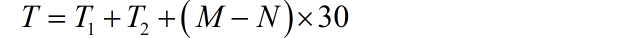

# 文杰杯视觉方向：赛题与算法资料调研

调研日期：2026-11-13。对象：负责软件算法的队员。结论依据：本地宣讲 PPT、赛事相关作者原文、厂商官方文档、算法官方文档及原始论文。硬件现已锁定，新增[硬件v0.3基线](../hardware-profile.md)和[TC264仓库重筛](2026-11-13-tc264-v03-repository-selection.md)；赛题规则仍按本文证据区分宣讲版与最终版。

## 1. 已确认的赛题

本地来源：[宣讲 PPT](<../“文杰杯”智能车挑战赛宣讲会5.24(1).pptx>)，封面日期 2026-05-24，共 21 页。[文本提取](ppt-text.md)保留了各页文本；图片另行核验，不能只依赖文字提取。

| PPT 页码 | 已确认内容 | 软件影响 |
| --- | --- | --- |
| 11 | 视觉识别方向为“疯狂电路组”；串联、并联、串并联反馈三个科目 | 逐级完成循迹、支路选择、回路覆盖 |
| 11 | 可遗漏部分元器件，遗漏会影响成绩；并联支路在五个之内 | 必须权衡覆盖数量、时间和完赛概率 |
| 12 | 深色底、白色线路；电容/开关存在间断，电感/灯泡等产生几何干扰，三端器件产生分支 | 需要跨断线、识别有效出口；不能把所有白色分叉都当路口 |
| 13 | 单科成绩 T = T₁ + T₂ + 30 × (M − N)；N ≥ 2，否则失败 | 漏一个元器件损失 30 秒，覆盖收益大 |
| 13 | 未完赛/放弃的科目按 278 秒；三个科目累加 | 保留低风险可完赛策略 |
| 13 | 元器件下面的红外检测装置判定通过；传感器原则上使用摄像头 | 车上估计的通过数量不等于裁判实际计数 |
| 14 | 推荐 130 有刷四轮套件、逐飞例程、曝光/二值化/大津法/节点判断/状态机 | 使用已选定硬件的厂商 BSP，再实现应用算法 |
| 18 | 计划决赛为 2026 年 11 月双创教育周 | 当前已是该月，不能照搬 PPT 的夏季长期安排 |
| 20 | 宣讲称可使用符合规则的其他硬件 | 不能直接套用全国赛指定芯片要求 |

第 13 页原始公式图片：

第 12 页三种赛道示例：[串联](ppt-assets/image18.png)、[并联](ppt-assets/image19.png)、[复杂网络](ppt-assets/image20.png)。这些是宣讲示例，不代表决赛地图。

PPT 第 4 页称详细评分稍后在群内公布，第 20 页对基础完赛的描述也较概括。因此上表是**宣讲版本**，不能代替赛前最终规则。

## 2. 来源清单与阅读顺序

以下链接于调研日查找。网页可读、链接存在、视频已观看、附件已下载是不同状态，本表明确区分。

| 编号 | 来源与链接 | 使用方式与访问情况 |
| --- | --- | --- |
| S1 | [华东师范大学创新创业学院重要通知](https://sie.ecnu.edu.cn/_s542/zytz/list.psp) | 学校官方通知列表可检索到“文杰杯”5月24日宣讲会；用于核对赛事背景，没有查到可直接替代群内最终细则的完整规则 |
| S2 | [卓晴：疯狂电路赛道制作与计分标准](https://aiot.csdn.net/69df665054b52172bc6a1b4a.html) | 已读取署名卓晴的作者文章页面；有器件、间距、绝缘区域等技术描述，属于全国赛相关资料 |
| S2a | [上述文章原博客入口](https://zhuoqing.blog.csdn.net/article/details/154691219) | 由作者文章链接定位；直连抓取受限，以 S2 可读正文辅助阅读 |
| S3 | [逐飞官方文档站](https://www.seekfree.com.cn/) | 已读取；按照实际主控选择核心板、驱动例程、编译环境 |
| S4 | [逐飞官方 Gitee 仓库目录](https://gitee.com/seekfree/projects) | 可检索多种芯片开源库；硬件型号明确后再选对应仓库，不默认 STC |
| S5 | [逐飞总钻风摄像头文档](https://www.seekfree.com.cn/产品资料/传感器/图像传感器/总钻风/) | 已读取；含 MT9V032/034 手册、供电、配置与常见问题资料入口；仅在实际型号匹配时适用，网盘资料未下载 |
| S6 | [逐飞助手官方文档](https://www.seekfree.com.cn/上位机/逐飞助手/) | 已读取；用于串口、波形、摄像头图像调试；使用通信功能须服从本次校赛规定 |
| S7 | [逐飞官方演示视频目录](https://www.seekfree.com.cn/视频资料/演示车模视频合集/) | 已读取，目录明确列出第21届疯狂电路演示 |
| S7a | [逐飞疯狂电路演示视频](https://www.bilibili.com/video/BV1zHmjBFEvk/) | 从官方目录取得；B站直连返回412，未完整观看，不据此推断内部算法或源码开放情况 |
| S8 | [卓晴：疯狂电路赛道制作视频](https://www.bilibili.com/video/BV1Xx27BHECH/) | 检索到作者发布条目；用于了解赛道外观，未完整观看 |
| S9 | [OpenCV：阈值处理](https://docs.opencv.org/4.x/d7/d4d/tutorial_py_thresholding.html) | 官方教程，已读取；比较固定阈值、大津法、自适应阈值 |
| S10 | [OpenCV：形态学](https://docs.opencv.org/4.x/d9/d61/tutorial_py_morphological_ops.html) | 官方教程，已读取；用于离线对照，不意味着整套 OpenCV 要装上 MCU |
| S11 | [OpenCV：相机标定](https://docs.opencv.org/4.x/d9/d0c/group__calib3d.html) | 官方文档，已读取；用于畸变和像素到地面映射，标定后可导出查表数据 |
| S12 | [Coulter：Pure Pursuit 原始技术报告](https://www.ri.cmu.edu/publication_view.html?pub_id=278) | CMU 官方论文介绍页，已读取；作为几何跟踪的进阶方案，不作为首版硬性依赖 |
| S13 | [NetworkX：Dijkstra](https://networkx.org/documentation/stable/reference/algorithms/generated/networkx.algorithms.shortest_paths.weighted.dijkstra_path.html) | 官方文档，已读取；用于已知图中的非负代价最短返回路径 |
| S14 | [NetworkX：eulerize](https://networkx.org/documentation/stable/reference/algorithms/generated/networkx.algorithms.euler.eulerize.html) | 官方文档，已读取；该函数最小化补边数量，不直接最小化实际行驶时间，不能直接当加权最优覆盖求解器 |

建议先看 PPT 11—14 页及 S7，再看 S3/S5/S6 完成采图和运行，接着用 S9/S10 做视觉对照，最后读 S12—S14。先获得本车图像，比泛读算法更能确定问题。

## 3. 算法路线比较

以下是根据赛题提出的工程方案，不是宣称厂商采用了这些算法。

| 方案 | 代价与能力 | 适用性 |
| --- | --- | --- |
| A：扫描线循迹、规则穿越、状态机、拓扑路线 | 资源需求可控、易查错；须专门处理断线、三端器件、相似路口 | **推荐作为竞赛主线** |
| B：在 A 上增加局部骨架图和标定后的 Pure Pursuit | 出口方向和路径表达更完整；耗时、内存及调参工作增加 | A 稳定后，按回放失败样本增加 |
| C：轻量模型做局部元器件/出口检测，传统算法闭环控制 | 有标注及目标板推理支持时可处理复杂外观；需要训练、部署、验证 | 仅在有充分工期、算力且规则允许时研究 |

首版目标是识别“可走的入口和出口、元件区域、真实路口”，不必先把每个电路符号分类到具体器件型号。电路电流方向和二极管箭头不自动等于车辆单行规定，车辆通行方向须由赛规单独确认。

## 4. 会影响实现的未确认项

已确认TC264_BTB/TC264D、MT9V034/120°、130双电机差速、DRV8701E双驱V1.3、两只1024线增量编码器、IMU660RB和IPS114。型号选型不再是阻塞，剩余事项如下。

1. 主板V1.1原理图/实物连接、已有ADS工程、相机实际采集时序及.map中的分区可用RAM；188×120是初始目标，不是已经实测的采集结果。
2. 已确定左右独立差速；编码器和IMU是否允许用于闭环或辅助定位仍须校赛方确认。“原则上均使用摄像头”需要解释。
3. 最终评分公式、T₂ 重量换算、重复通过是否只计一次、三端器件怎样算通过、超时上限。
4. 发车区能否中途再经过、终点判定特征、是否允许掉头/倒车、是否存在指定方向。
5. 地图是否提前给出、能否手动录入路线、是否允许赛前采图，是否要求完全在线探索。
6. 赛道印刷/铺设介质与实际底色、线宽、断口尺寸、绝缘区/边界处罚、现场照明。
7. 比赛准确日期、试跑次数、三科目是否保留、最新群公告版本。

处理原则：最终校赛公告 > 宣讲 PPT > 全国赛参考资料 > 经验文章。存在冲突时保存两种说法及日期，再向校赛组织方核对。现阶段默认车载摄像头感知、无外部电脑遥控；编码器等按允许情况适配；路线录入能力保留但在获知允许前不将其作为唯一方案。

## 5. 完成范围

已完成资料调研、21页文本提取、5个嵌入图片/动画素材提取及实现计划，并按用户v0.3补充硬件核验和仓库重筛；原始PPT保留不变。第三方源码只读取与静态检查，没有声称已经编译、训练或实车验证算法。

下一份文档：[软件算法实现计划](../superpowers/plans/2026-11-13-wenjie-vision-algorithms.md)。
