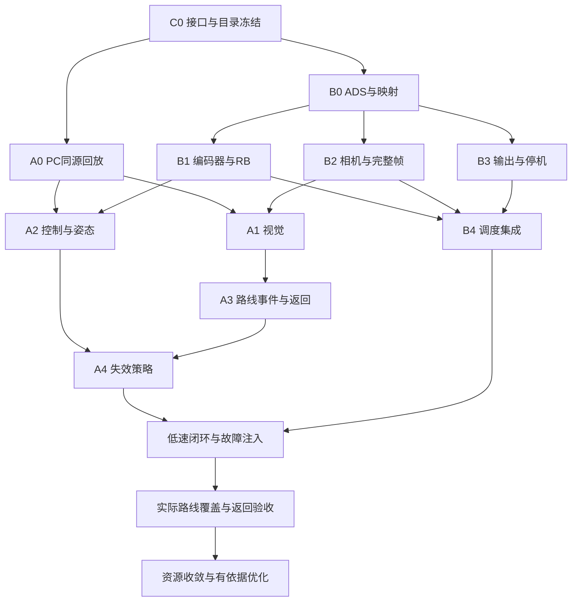

# 算法与硬件接入：分工及改进准备计划

> **For agentic workers:** 按本计划的工作包逐项实施、逐项验证；任务状态不得仅凭文件存在改为完成。当前仅制定准备计划，尚未执行固件改造，不启动额外代理。

**Goal:** 将当前参考基线推进为本车可构建、可低速闭环、可验证覆盖与返回的比赛软件。

**Architecture:** 算法使用一份纯C核心供PC/TC264共享；接入侧统一采样、物理单位、帧所有权、运行调度与执行输出。按[分工设计](../specs/2026-11-14-algorithm-hardware-worksplit-design.md)交接，源码快照只读。

**Tech Stack:** C99/C11兼容子集、TC264/ADS/逐飞库、PC GCC/CMake候选工具链、MT9V034、IMU660RB、双编码器和DRV8701E。CMake是否安装由A0核实；Webots为后续验证工作包，不是当前已可用环境。

## 1. 范围与状态

起点提交`706d7ff`，当前应用尚未移植。A为算法负责人（建议由你牵头），B为硬件接入负责人；C编号表示必须双方验收的交接工作，不是第三组。未指定姓名或工期；以下按依赖推进，不用未经确认的决赛日期倒排承诺。

本计划是工作包与验收安排，细化代码前先冻结对应接口和输入数据。所有源码位置均为拟建路径，现有可读参考为`soberup/upstream/`；不得在上游直接修复。

## 2. 共同先行工作

### C0：基线、目录和接口冻结（A主责，B验收）

产物：`src/interfaces/car_types.h`、`docs/validation/interface-contract.md`、`docs/validation/build-baseline.md`。

- [ ] 双方阅读软件专项审计，将SW01—SW10转为本计划负责工作包。
- [ ] 固定共享C目录与ADS引用方式，列明唯一SDK版本和编译器；禁止两套SDK同时链接。
- [ ] 形成FrameView、WheelSample、ImuSample、VisionObservation、MissionCommand、MotorCommand和RunRecord的纯C类型及单位说明。
- [ ] 明确图像借用/释放、seq/时戳、无效样本、左右符号、故障锁存、重新启动与配置版本；B确认能由设备层提供。
- [ ] A/B先各用PC最小调用方验证头文件独立包含，不经逐飞总头即可编译；不在这一阶段搬入整车全局变量。ADS端的同头验证在B0完成，C0不依赖尚未建立的ADS工程。

通过条件：接口无SDK依赖，字段生产者/消费者唯一，单位和有效期明确，双方编译入口能接收相同类型。该阶段只证明交接协议可用，不代表驱动/算法已完成。

### C1：实物与数据交接准备（B主责，A验收）

产物：`docs/validation/board-pinmap.md`、`config/calibration/vehicle-v03.json`、`tests/data/manifest.csv`。

- [ ] B按实物填写PWM/DIR/使能、编码器通道、相机、IMU、屏幕和串口映射，每项附原理图或实测依据；未确认项必须保持电机禁用。
- [ ] B交轮径、有效轮距初测、count/rev、编码模式、IMU轴映射、相机高度/俯角/曝光；未测参数明确标“未测”，不提供猜测运行值。
- [ ] A定义原始灰度帧清单字段：尺寸、seq、时戳、曝光、赛道元素、期望出口/行为、允许偏差与来源。
- [ ] B导出首批本车原始帧，A检查尺寸、完整性及元件/T口可见性；无实物时使用标明来源的合成帧开发，并保持“本车验证未完成”。

通过条件：数据可读取、参数来源可追踪；不要求等齐所有场景才启动A1，但不能用合成帧结束实车验收。

## 3. A线：算法工作包

### A0：PC同源构建与输入回放

路径：`host/CMakeLists.txt`、`host/replay/`、`tests/data/manifest.csv`、`docs/validation/host-results.md`。依赖C0。

- [ ] 确认可用GCC及构建工具，建立只编译共享核心与PC适配的入口。
- [ ] 原始帧输入后导出二值图、边界/中线叠加、出口、状态、有效性及耗时记录。
- [ ] 用全黑、全白、边界像素、缺帧、无效尺寸检查拒绝/失效行为；内存边界检查可使用主机工具，但不能替代板上内存验收。

交付：可复现运行说明和结果文件；只调Python替代算法不通过此包。

### A1：视觉核心提取与本车标定

路径：`src/core/vision/`、`config/vision/`、`tests/vision/`。参考image、maze、element_line、dashedline_makeup、line；依赖A0，C1数据持续补充。

- [ ] 去除设备全局图像、路线全局变量和屏幕输出，输入只读FrameView，输出完整VisionObservation。
- [ ] 保留有必要的阈值/补线/边界逻辑，先形成可解释基线，再以失败样本决定复杂模块。
- [ ] 重新标定ROI与每行线宽/距离，不照搬16cm表；控制补线范围，防止连接相邻支路。
- [ ] 验证线宽15/20/25mm、直角/弯道、T口、三端器件、阴影和伪分支；给出有标签的误判样例。
- [ ] 核算四点集和备份数据；减少非必要缓存，满足算法桶并保留测量记录。

交付：相同输入可重复结果，越界/退化帧处理明确，参数绑定本车标定版本。

### A2：运动控制与姿态计算

路径：`src/core/control/`、`src/core/attitude/`、`config/control/`、`tests/control/`。参考motor的数学部分和Mahony算法部分；依赖C0，可用合成传感器样本先做。

- [ ] 明确v/omega、轮目标、反馈m/s与dt；按冻结周期重新确定PID、滤波和抗饱和，不照搬500Hz参数到200Hz。
- [ ] 姿态算法只消费新的物理量样本，统一rad、rad/s和轴向；不直接调用RC/RB设备函数。
- [ ] 验证零目标、正向阶跃、输出饱和、停机复位、丢样本、可选负轮目标；负轮行为与B3能力保持一致。
- [ ] B提供实际阶跃/制动数据后修订模型和增益，保留低速参数版本。

交付：同源控制与姿态核心、量纲说明、仿真/采样对照和参数版本；PC模型有效不代表电机已调好。

### A3：路线、路口状态与覆盖核对

路径：`src/core/mission/`、`config/routes/`、`host/replay/`、`tests/mission/`。参考state_control、route_config、route_progress；依赖A1事件协议，实际地图到位后完成配置。

- [ ] 使用本校科目ID，隔离原预赛/决赛语义；明确发车方向、路线步骤、返回区及适用门槛。
- [ ] 进入/退出路口分开，按帧/距离去抖，验证重复T口不重复推进、漏检后不会无界盲走。
- [ ] 对公布地图建立路线与元件集合对照；可人工离线验证，不强制在线规划或元件名称识别。
- [ ] 验证正常返回、中途误穿起点、覆盖不足、指定方向变化及现场任务；国赛口径另验75%。
- [ ] 决定是否迁移原里程纠偏；迁移则明确每帧更新入口并用事件回放验证，不迁移则不依赖它的默认状态。

交付：路线配置、事件回归和覆盖/返回对照。地图未提供时仅可验状态机逻辑，不能宣称路线完赛。

### A4：失效策略与完成条件

路径：`src/core/safety/`、`src/core/mission/`、`tests/safety/`。依赖C0和A1/A2/A3的有效性语义。

- [ ] 区分视觉无效、图像过期、姿态无效、路线错误、任务超时和真实完成，停止不得伪记FINISH。
- [ ] 用实测延迟与停机数据制定图像过期/恢复窗口和任务保护超时；不写死13秒，也不把278秒当超时。
- [ ] 给出故障时目标归零、积分清理、状态锁存、重新启动条件，交B实现快速执行与时序验证。

交付：条件—动作表、异常事件回放和冻结的策略配置；平台硬故障可绕过A直接停机。

### A5：算法优化与仿真验收

路径：`host/sim/`、`tests/integration/`、`docs/validation/algorithm-results.md`。依赖低速基线完成后开展。

- [ ] 用实际失败样本优先优化错叉/误补线，测成功率和最坏处理量。
- [ ] 先做轻量差速/事件闭环模型；确有整车场景需要时加入Webots相机与差速模型，并继续调用同一C核心。
- [ ] 仿真裁判独立检查真实覆盖、返回和完整车体边界接触；不得把真值位置输给比赛算法。
- [ ] 区分轮目标速度直接执行的模型与含执行器动态、能检验轮速PID的模型；保存模型适用范围。

交付：覆盖不足但返回、覆盖足够但碰路肩等正反例，及算法优化前后的同集对比。仿真不能替代B的板上验收。

## 4. B线：硬件接入工作包

### B0：本车ADS工程与板级配置

路径：`firmware/vendor/TC264_Library/`、`firmware/ads/`、`src/platform/tc264/board_config.h`、`docs/validation/build-baseline.md`。依赖C0/C1映射准备。

- [ ] 锁定官方库和实际ADS/编译器版本，导入空应用，保存构建命令/设置和.map。
- [ ] 逐脚核对相机、PWM/DIR/使能、编码器、RB与IPS，列出中断/定时器/DMA冲突。
- [ ] 工程引用统一核心目录；保证原快照和两份SDK不会混入同一链接。

交付：可编译、可下载、自检时保持电机关闭的本车工程，不使用猜测引脚。

### B1：编码器与IMU物理量接入

路径：`src/platform/tc264/board_port.[ch]`、`config/calibration/`、`docs/validation/sensor-results.md`。依赖B0。

- [ ] 按接线确定A+DIR或AB、边沿计数和硬件通道；实测整轮正反转count，处理回卷及读清竞态。
- [ ] 输出时戳、dt、有符号增量、速度和里程，校准每轮转换系数；左右前进均为正。
- [ ] 改用RB通信与物理量转换，自检、轴向、ODR/量程和静止数据交A2；保证同一个样本不重复标为新采样。

交付：人工转轮、静止、定角转动、换向和缺样本记录，A核对单位及方向。

### B2：相机采集与帧所有权

路径：`src/platform/tc264/board_port.[ch]`、`docs/validation/camera-results.md`、`tests/data/`。依赖B0，向A0/A1持续交帧。

- [ ] 初始化188×120并测实际FPS、曝光和采集窗口，输出完整灰度而非只导出二值图。
- [ ] 实现帧边界握手停采/恢复或已验证的乒乓方案；算法持有帧时DMA不得改写它，不能只加memcpy。
- [ ] 获取/释放前后检查seq和缓冲完整性；允许跳帧但不无界排队或半帧恢复。
- [ ] 记录停止帧输入、DMA异常和采集延迟，供A4确定失效策略。

交付：连续帧/慢消费者/故障注入记录，证明所有权协议在板上成立。

### B3：驱动执行与立即停车

路径：`src/platform/tc264/board_port.[ch]`、`docs/validation/actuator-results.md`。依赖B0，电机先架空。

- [ ] 实测PWM/DIR/使能极性、频率、范围、零输出和停车动作；建立归一化输出到硬件映射。
- [ ] 验证反向能力；若本阶段仅支持前进，显式拒绝需要反向的配置，不能悄悄把负输出当正确执行。
- [ ] 输出超限、失效命令或硬故障时立即关驱动并锁存原因，禁止500ms延时进入快速故障路径。
- [ ] 测请求停机到驱动关闭延迟、实际停止距离及测试速度；数据交A2/A4。

交付：零/正/负命令、急停、故障锁存及再使能记录；确认前不进入地面高速测试。

### B4：启动、调度、观察发布和后台任务

路径：`src/platform/tc264/app_runtime.[ch]`、`firmware/ads/`、`docs/validation/timing-results.md`。依赖C0/B1/B2/B3；可先用桩核心验证。

- [ ] 完成SELF_TEST→READY→运行组织，放行后不再次异步重置INS/核心；启动前必须取得有效采样与合法配置。
- [ ] 固定控制周期，视觉处理最新完整帧；只有完整观察才能发布给控制，不让中间error=0暴露。
- [ ] 每帧正确调用已选路线推进，执行A4保护条件；任务保护超时来自配置，不保留13秒常量。
- [ ] 底层命令/采样失效能够自行停机；日志、Flash保存、屏幕放后台限频处理，不在控制IRQ阻塞。
- [ ] 记录视觉端到端年龄、控制超期、中断最长耗时和停机链路，处理毫秒时基回卷。

交付：桩核心与真实核心均可重复启动/停止、无异步重置、故障路径可追踪的运行框架。

### B5：链接资源、配置装载与板端交付

路径：`firmware/ads/`、`src/platform/tc264/`、`docs/validation/resource-results.md`、`docs/validation/board-results.md`。依赖各模块集成。

该包从B0起随集成增量执行；M2低速上车前必须先通过当轮.map和基本时序检查，M4再完成持续负载与最终资源报告，不能到跑完路线后才检查内存。

- [ ] 用.map核对各段、采集图、算法数组、栈和CSA；算法A负责大小，B负责地址/链接布局，统一核账不重复计数。
- [ ] 关闭大轨迹和完整IPS帧，使用局部刷新；验证实际栈水位、中断嵌套和持续负载。
- [ ] 装载带版本和范围检查的本车配置；接口版本/标定不匹配时拒绝发车，不使用未知默认值兜底运行。
- [ ] 交固件、工具链/SDK版本、配置、资源与时序报告，并保留低速稳定版本。

交付：240KB分区与96/96/48KB预算通过，实际耗时满足已冻结目标，PC/板端同帧输出在约定容差内一致。

## 5. 现有问题主责表

| 审计问题 | 主责工作包 | 配合与关闭条件 |
| --- | --- | --- |
| SW01 RC/RB及GPIO差异 | B0/B1/B3 | A2使用统一物理量；实物独立驱动通过 |
| SW02 原赛道配置/返回未证明 | A3 | B4装载执行，实际路线覆盖与返回证据通过 |
| SW03 13秒固定停车 | A4定义策略，B4移除固定机制 | 长于13秒的合法测试不被误停，真实超时仍停 |
| SW04 DMA覆盖处理中帧 | B2 | A1正确借用/释放；慢消费者和连续帧验证通过 |
| SW05 error中间值/图像过期 | A1/A4给结果和条件，B4原子发布/执行 | 不发布半结果，停止更新后受控停车 |
| SW06 纠偏每帧更新缺口 | A3 | B4连接真实调用链；启用时窗口推进回归通过 |
| SW07 放行后重复重置 | B4 | A2/A3提供统一reset入口；重复启动和放行时序通过 |
| SW08 停车阻塞500ms | B3/B4 | A4消费首个故障；驱动立即关闭，后台延后处理 |
| SW09 负PWM未执行 | B3 | A2约定能力范围；真实反向或显式禁用需求验证 |
| SW10 原标定/周期/取整 | B1提供采样标定，A1/A2消化参数 | 符号/单位/周期一致，板端与PC结果符合容差 |

硬件PCB自制资格归B提供材料、队伍按适用赛事检查，不算算法实现任务。规则75%覆盖属于A3和联合验收条件，不能仅列为A5性能优化。

## 6. 并行关系与联合里程碑

| 里程碑 | A交付 | B交付 | 双方通过条件 |
| --- | --- | --- | --- |
| M0 能交接 | 纯C类型、PC最小调用方 | ADS最小调用方、引脚来源 | 同一接口、明确单位和版本 |
| M1 能独立验证 | 合成/真实帧回放、控制样本测试 | 灰度帧、轮速/RB数据、架空驱动和停机 | 无需等待完整路线即可各自复现结果 |
| M2 能低速闭环 | 有效观察、控制参数、失效策略 | 完整帧、调度和故障执行、当轮.map与时序基线 | 当轮资源/基本时序通过后持续循线；停帧/失线/重启等不造成无界运动 |
| M3 能满足该场次行为 | 校赛三科或相应场次路线与覆盖对照 | 固件执行与原始日志 | 真实返回、N达标、无禁入接触；国赛口径另验75% |
| M4 能稳定交付 | 同帧回归、优化前后对比 | .map、栈/CSA、最坏耗时和稳定固件 | 预算通过，配置/固件版本可复现，失败记录完整 |

不得用M1视频代替M3；不得用PC通过代替板上时序通过。19/20次有效可作为内部稳定性目标，不能替代官方覆盖门槛。

## 7. 第一批可以直接领取的任务

- [ ] **你/算法负责人：C0＋A0。** 先冻结数据契约并建立同源回放；随后A1提取视觉、A2提取控制，可在硬件准备期间推进。
- [ ] **硬件接入负责人：C1＋B0。** 先核对引脚和ADS构建，随后B3证明可停止，再推进B1/B2并交原始数据。
- [ ] **双方：M0/M1交接。** 交换头文件、原图/传感器样本、控制输出样本和配置版本；对同一输入比较输出，记录差异归属后进入低速闭环。

实现之前的准备交付是本文和[分工设计](../specs/2026-11-14-algorithm-hardware-worksplit-design.md)。执行过程中每个工作包单独提交可检查的结果，保留原样上游及许可；本轮未将任何待实现工作勾选为完成。
